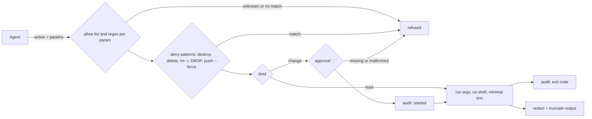

# control-mcp

A small, local MCP server that lets a coding agent operate infrastructure through an **allow list** instead of a shell: OpenTofu plans and applies, DNS checks, deploys — whatever your wrapper scripts do. It is a template of the control server we run at VAIEV, with the project specifics removed.

## Quickstart

```bash
cd control-mcp
python3 -m venv .venv && .venv/bin/pip install -r requirements.txt
cp control.example.toml control.toml        # adapt: actions, workdir, audit log
python3 tests/test_control_core.py          # no SDK needed for the tests
```

Register it as a stdio server in your agent CLI, for example in Claude Code's `.mcp.json`:

```json
{ "mcpServers": { "control": { "command": ".venv/bin/python", "args": ["control-mcp/server.py"],
                               "env": { "CONTROL_CONFIG": "control-mcp/control.toml" } } } }
```

## Tools

| Tool | What it does |
|---|---|
| `list_actions()` | The allowed actions with kind, description and parameter names |
| `run_read(action, params)` | Runs a `read` action; refuses `change` actions |
| `run_change(action, approved, params)` | Runs a `change` action with the owner's approval `"<who> <YYYY-MM-DD>: <what>"` |

## Rules it enforces



- **No shell:** every action is an argv list from `control.toml`; parameters are filled in only after they match their regular expression in full.
- **Deletions stay with a human:** the built-in deny list refuses destroy/delete commands even with an approval; add your own patterns under `settings.deny`.
- **Approvals are explicit and logged:** change actions need `approved="<who> <YYYY-MM-DD>: <what>"`. The audit log (a Markdown table, e.g. `docs/OPS-LOG.md`) gets a line before the command starts and one with its exit code. The child process sees the approval as `CONTROL_APPROVED` / `CONTROL_APPROVED_BY`, so your wrapper can log it too.
- **Secrets stay out of the transcript:** commands get a minimal environment (`PATH`, `HOME`, locale, plus `settings.env_passthrough`); their output is redacted (private key blocks, age secret keys, GitHub tokens, bearer/basic credentials, `password=`-style pairs, credentials in URLs) and truncated. Wrapper scripts read credentials themselves at call time.

## Limits

- Redaction is pattern-based. A wrapper that prints a secret in an unknown format leaks it: make wrappers print results, never credentials.
- The approval string proves that the agent passed it, not who wrote it. Pair it with your CLI's permission prompt for MCP tools and review the audit log.
- One action runs at a time per call; long jobs should run under systemd or CI and be polled with a read action.

## License

Apache License, Version 2.0 (see the repository's `LICENSE`).
