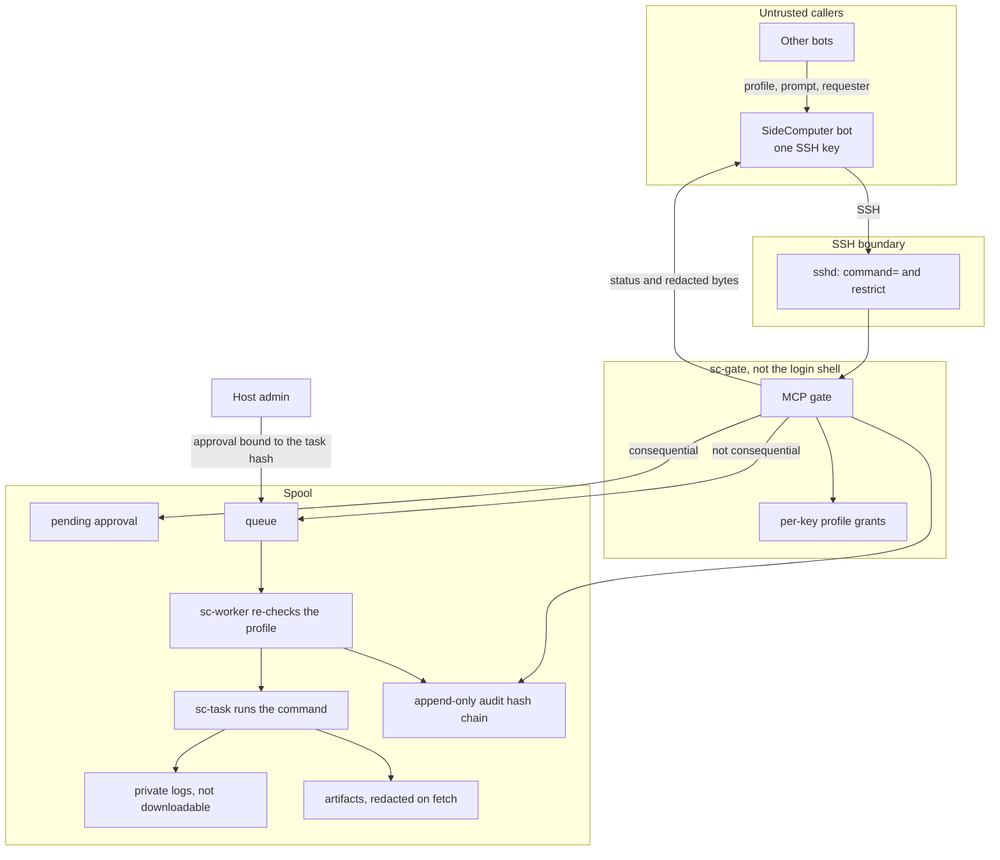

# SideComputer

A 24/7 Linux host that one owner's bots can use as a second computer. One bot holds the SSH key. After bootstrap that key can only speak MCP to a gate: submit a task, read status, fetch a redacted artifact. No shell, no file access, no port forwarding, no key rotation.

## Quickstart

On the bot's machine, make a key and keep the private half there:

```bash
ssh-keygen -t ed25519 -f sidecomputer-bot -N ""
```

On the host, as root, install one or more profiles and pin that public key to the gate:

```bash
sudo ./bootstrap.sh \
  --profile compute,repo-bridge \
  --bot-pubkey sidecomputer-bot.pub \
  --mode strict
```

Bootstrap prints one JSON line. `strict` sets `command=` and `restrict` on the key and `ForceCommand` for the `sidecomputer` user. Re-running replaces that key line instead of adding another. There is no MCP tool for key rotation; rotation is this admin command, and every `authorized_keys` entry keeps `command=` and `restrict`.

Pin the host key before the client will connect. The client refuses a missing `known_hosts` file (no trust-on-first-use). `--accept-new` is the one-time opt-in:

```bash
python3 -m pip install paramiko
ssh-keyscan -H HOST >> ~/.ssh/known_hosts
export SIDECOMPUTER_SSH_KEY="$(cat sidecomputer-bot)"
python3 client/sc_client.py --host HOST --user sidecomputer \
  --key-env SIDECOMPUTER_SSH_KEY --known-hosts ~/.ssh/known_hosts tools
```

`compute` is a consequential profile, so the task waits until someone at the host console approves it:

```bash
python3 client/sc_client.py --host HOST call submit_task \
  '{"profile":"compute","command":"make test","timeout":600,"requester":"owner-bot"}'
# on the host, as root:
sudo sidecomputer-approve TASK_ID
python3 client/sc_client.py --host HOST call task_status '{"id":"TASK_ID"}'
```

You get state, exit code, duration, and a redacted summary. `request_artifact` returns file bytes only after the same redaction, so a redirected `cmd > out.txt` does not hand back secrets or IP addresses.

`SC_PREFIX` and `SC_DRY_RUN=1` install into a scratch directory. Tests:

```bash
python3 -m pip install paramiko
python3 sidecomputer/tests/test_sidecomputer.py
```

## Architecture and threat model

Callers are untrusted. The bot, its prompts, and any other bot that hands it a task may be manipulated, and the SSH key may leak. The host only runs work that a granted profile allows, and the bot only sees redacted results.



| Boundary | What it stops |
|---|---|
| `command=` and `restrict` | A leaked key getting a shell, a file transfer, or a forward. |
| Grants | That key using every profile. It only sees tasks it submitted. |
| Worker re-check | A queue file that asks for a command the profile does not allow, or a timeout past the profile max. |
| Host approval | The bot approving its own shell, network, or other consequential task. |
| `IPAddressDeny=any` | Tasks reaching the network unless a profile opts in and a cgroup scope can enforce it. |
| Redaction | Raw secrets and IPs in summaries and in downloaded artifacts, including `cmd > out.txt`. |
| Hash-chained audit log | A rewritten or gapped history. Each record has the key id and the requester. |

What a caller can do: `submit_task`, `task_status`, `list_tasks`, `cancel_task`, `list_profiles`, `request_artifact`, `health`.

What it cannot do: run a shell, read or write files, forward ports or an agent, install tools, add profiles, rotate the SSH key, approve its own consequential task, or read raw stdout/stderr. `stdout.log` and `stderr.log` are not artifacts.

Other bots never receive the key or the host address. They hand the SideComputer bot a profile, a command or prompt, a timeout, and a requester. The dispatch skill is [vaiev/skills `sidecomputer/dispatch/SKILL.md`](https://github.com/vaiev/skills/blob/main/sidecomputer/dispatch/SKILL.md).

## Layout

| Path | Purpose |
|---|---|
| `bootstrap.sh` | Root-run, idempotent host setup. Prints a JSON summary. |
| `scripts/sidecomputer-gate.sh` | SSH forced command. Runs the gate as `sc-gate`. |
| `gate/gate.py` | MCP stdio server (JSON-RPC 2.0, stdlib only). |
| `gate/worker.py` | `sidecomputer-worker.service`. Re-validates, then runs the task. |
| `gate/sclib.py` | Spool policy, profile checks, redaction, audit chain, grants. |
| `gate/approve.py` | Host-console approval. Not an MCP tool. |
| `gate/chown_artifact.py` | Root helper that lends one artifact directory to `sc-task` and takes it back. |
| `profiles/*.json` | `worker-cli-agents`, `repo-bridge`, `compute`, `custom`. |
| `client/sc_client.py` | Paramiko client: `tools` or `call <tool> <json>`. |
| `tests/` | `python3 tests/test_sidecomputer.py`. |

## Bootstrap

```bash
sudo ./bootstrap.sh --profile compute,repo-bridge \
  --bot-pubkey "ssh-ed25519 AAAA... bot" --mode strict [--lock]
```

This creates `sidecomputer` (login, password locked), `sc-gate`, `sc-worker`, and `sc-task`. The login user is not in the spool groups. Only `sc-gate` can create queue files. Only `sc-worker` can write results. `sc-task` runs the command and cannot read the queue, other tasks' directories, private logs, or the audit log. The audit log is append-only and hash-chained.

The worker unit sets `IPAddressDeny=any` and `IPAddressAllow=localhost`, plus MemoryMax, CPUQuota, TasksMax, NoNewPrivileges, ProtectSystem=strict, and ProtectHome. sshd disables password and keyboard-interactive authentication. Memory is the cgroup `MemoryMax`. The worker does not set `RLIMIT_AS`, because a 4G address-space limit breaks Node and V8. A prompt is passed after `--`, so a value that starts with `-` is not a runner flag.

Profiles are validated before they are installed. Invalid profile files are ignored. Packages install with apt; `mcps` entries install with npm when those tools exist.

### Modes

- **strict** (use this): `command="/usr/local/bin/sidecomputer-gate",restrict` on the key, plus `ForceCommand` for the user. `--lock` also empties the admin user's `authorized_keys` (a backup is left beside it) and sets `PermitRootLogin no`.
- **open** (less safe): the bot key still has `command=` and `restrict`, so it still cannot get a shell. sshd does not set `ForceCommand` for the whole user. Use it only while debugging.

After `--lock`, the only SSH path left is the gate. Re-bootstrap, key rotation, and profile changes need the console or a provider rescue path, or an admin key you kept somewhere else.

## Tasks

`submit_task` takes a profile and exactly one of `command` or `prompt`, plus an optional timeout and requester. The timeout is clamped to the profile maximum. If the profile allows a raw command, enables network, or sets `requires_approval`, the task stays in `pending` until root runs:

```bash
sudo sidecomputer-approve TASK_ID
```

The approval is a hash of the task. Editing the command after approval makes the worker reject it. The worker also rejects a queue file whose kind the profile does not allow.

A profile that sets `network: true` or `egress_allow` is asking to leave the default deny. The worker refuses that task unless a privileged cgroup scope can apply the allow list. Shipped profiles leave `network` false.

`request_artifact` serves one safe name from `artifacts/<id>/`, under the profile byte cap, and writes the request to the log. The returned bytes are redacted (PEM keys, JWTs, common token shapes, `secret=` pairs, URL credentials, emails, IP addresses, long hex or base64 blobs, then a printable-ASCII allowlist). Symlinks are not served.

The summary is at most 500 characters from the tail of the output, with the same redaction. The raw task input is dropped from the done record.

## What this does not promise

A profile with `allow_command: true` runs a shell as `sc-task` after a human approval. The limits are the user, the cgroup, and redaction, not a command filter. Redaction is a heuristic. Do not send secrets through tasks.

Tasks share the `sc-task` user one at a time. Private logs, the queue, and the audit log are not owned by that user. The prompt runner in `worker-cli-agents` (`sc-agent-runner`) is a placeholder for the CLI agent an admin installs.
